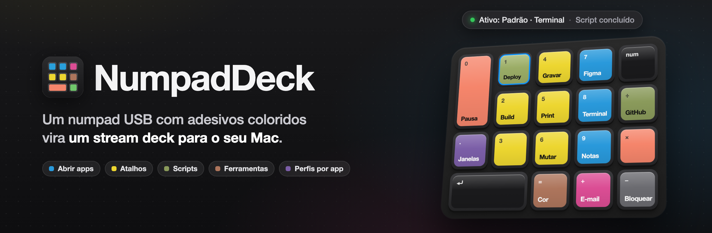
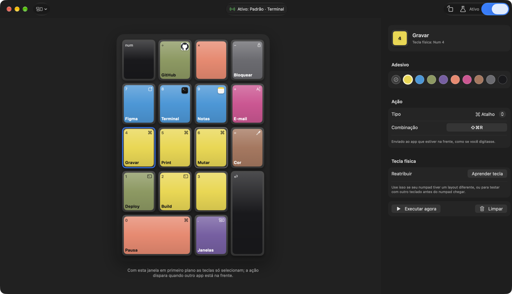
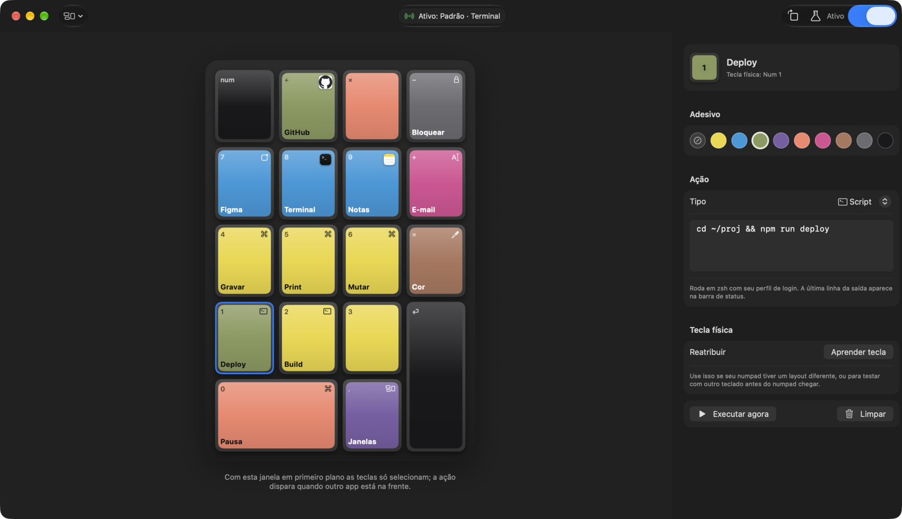
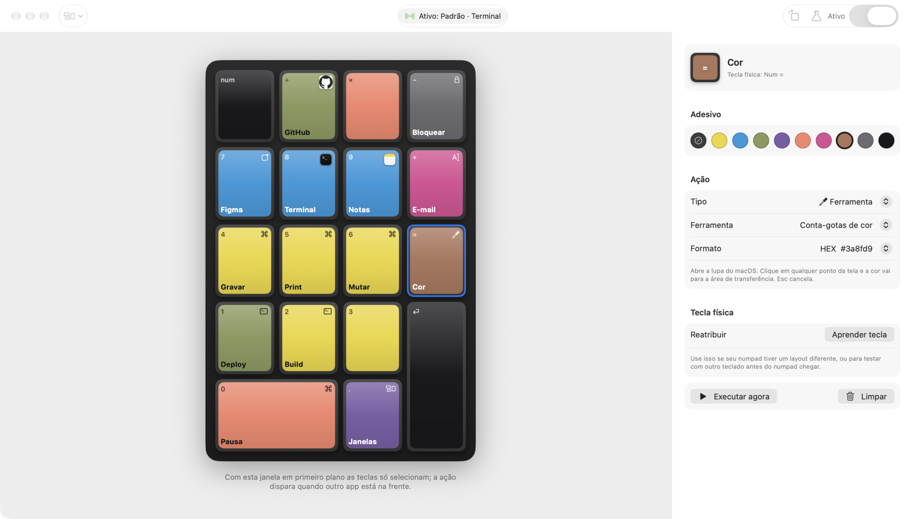
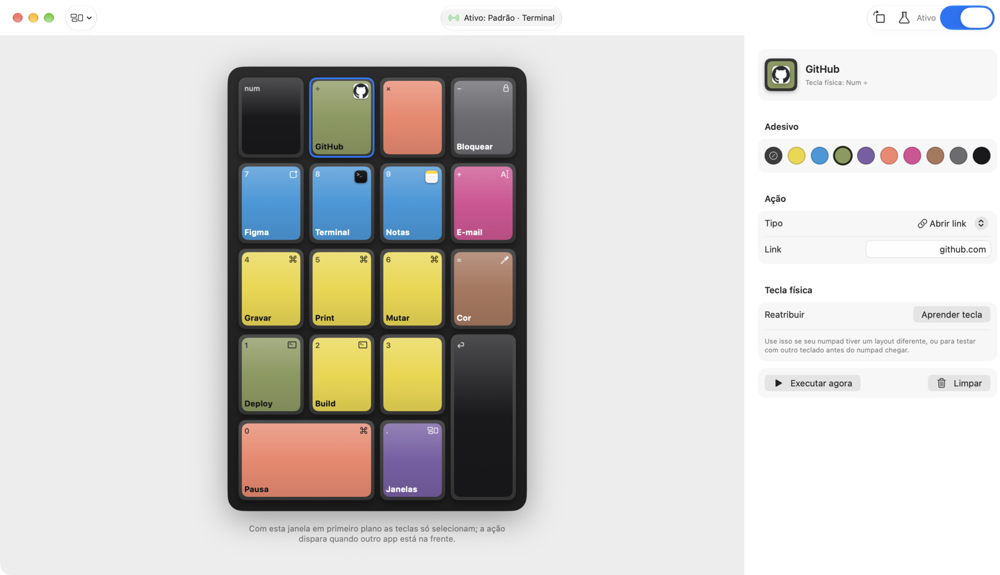
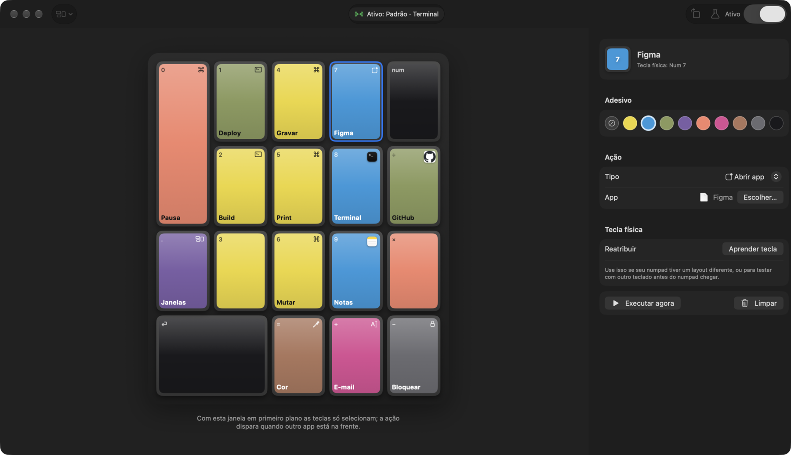
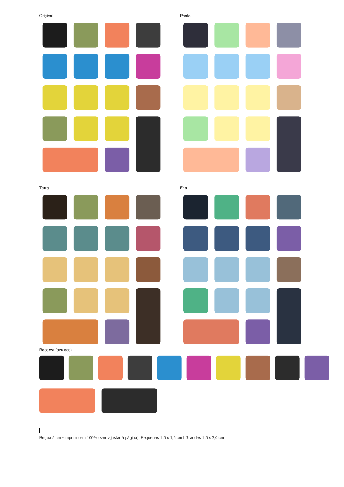

<p align="center">
  
</p>

<p align="center">
  
  
  
  
</p>

**NumpadDeck** transforma um numpad USB barato num stream deck. Cada tecla física ganha um adesivo colorido; o app desenha a mesma grade na tela, com as mesmas cores. Você olha a cor na mesa, clica na tecla igual na tela e escolhe o que ela faz.

O app vive na barra de menus, não precisa de Xcode e guarda tudo num JSON local.

<p align="center">
  <picture>
    <source media="(prefers-color-scheme: dark)" srcset="docs/images/hero-dark.png">
    <source media="(prefers-color-scheme: light)" srcset="docs/images/hero-light.png">
    
  </picture>
</p>

## Como funciona

1. **Cole os adesivos** no numpad. O PDF pronto para a gráfica está em [`adesivos/`](adesivos).
2. **Clique numa tecla** na tela, ou aperte a tecla física para pular direto nela.
3. **Escolha a ação.** Ela dispara quando outro app está na frente.

## Ações

| Tipo | O que faz | Exemplo |
| --- | --- | --- |
| **Abrir app** | Abre ou traz para frente um app | Figma, Terminal |
| **Abrir link** | Abre uma URL ou um deep link | `github.com`, `obsidian://vault` |
| **Atalho** | Envia uma combinação ao app da frente | `⇧⌘R` para gravar a tela |
| **Script** | Roda um comando no zsh com seu perfil de login | `cd ~/proj && npm run deploy` |
| **Texto** | Digita um texto onde estiver o cursor. Uma quebra de linha no fim envia Enter | e-mail, `/clear` + Enter |
| **Ferramenta** | Ações nativas prontas, sem nada rodando em segundo plano | veja abaixo |

**Ferramentas embutidas**

- **Conta-gotas de cor**: abre a lupa do macOS e copia a cor em HEX, RGB, HSL ou `Color(...)` do SwiftUI.
- **Conectar por SSH**: testa a porta 22 de cada host na ordem e abre o Terminal já conectado no primeiro que responder.
- **Mudo**: liga e desliga o som do Mac.
- **Minimizar janela**, **Tela cheia** e **Fechar programa** para o app da frente.
- **Bloquear tela** e **Mission Control**.

## Recursos

- **Perfis por app.** Cada perfil tem seu próprio mapa de teclas e troca sozinho conforme o app em primeiro plano. O perfil sem apps é o padrão.
- **Status num relance.** A pílula da barra mostra se o deck está ativo, o perfil, o app da frente e a última ação.
- **Modo teste.** As teclas acendem na tela sem executar nada.
- **Aprender tecla.** Reatribui a tecla física de uma posição. Serve para numpads com outro layout e para testar com o teclado comum antes do numpad chegar.
- **Tecla amarrada ao numpad.** Teclas que também existem no teclado principal (`⌫`, `.`) só disparam quando vêm do numpad. No teclado do Mac continuam normais.
- **Girar.** A grade gira em 90° para acompanhar como o numpad está na mesa.
- **LED do Num Lock como luz de status.** Aceso com o deck ativo, pisca quando uma tecla dispara e pisca duas vezes quando o perfil muda.
- **Teclas livres passam direto.** Só as teclas com ação são capturadas.

## Telas

<table>
  <tr>
    <td width="50%"><br><sub><b>Script</b>: a última linha da saída aparece na barra de status.</sub></td>
    <td width="50%"><br><sub><b>Ferramenta</b>: conta-gotas que copia a cor em HEX.</sub></td>
  </tr>
  <tr>
    <td width="50%"><br><sub><b>Abrir link</b>: a tecla mostra o favicon do site.</sub></td>
    <td width="50%"><br><sub><b>Girar</b>: a grade segue o numpad deitado na mesa.</sub></td>
  </tr>
</table>

## Instalar

Precisa de macOS 14 ou mais novo e das Command Line Tools (`xcode-select --install`). Xcode não é necessário.

```sh
git clone https://github.com/allefrodrigo/numpad-deck.git
cd numpad-deck
./scripts/make-cert.sh   # uma vez: certificado local para a permissão não sumir a cada build
./scripts/build.sh       # gera build/NumpadDeck.app
./scripts/install.sh     # copia para /Applications e abre no login
```

Só quer testar? Rode `./scripts/build.sh` e `open build/NumpadDeck.app`.

### Permissões

| Permissão | Para quê | Onde ativar |
| --- | --- | --- |
| **Acessibilidade** | Capturar as teclas e enviar atalhos. Sem ela a interface funciona, mas nada dispara. | Ajustes › Privacidade e Segurança › Acessibilidade |
| **Monitoramento de Entrada** | Saber de qual teclado veio a tecla e acender o LED do Num Lock. Opcional. | Ajustes › Privacidade e Segurança › Monitoramento de Entrada |

O app avisa quando falta permissão e tem um botão que abre o painel certo.

## Usar

- Clique no ícone da barra de menus › **Configurar teclas…** (`⌘,`) para abrir a janela.
- Com a janela do NumpadDeck na frente, as teclas só selecionam. A ação dispara quando outro app está na frente.
- **Executar agora** testa a ação sem apertar a tecla.
- A configuração fica em `~/Library/Application Support/NumpadDeck/config.json`.

## Adesivos



[`adesivos/adesivos_numpad_A4.pdf`](adesivos/adesivos_numpad_A4.pdf) é uma folha A4 vetorial com quatro paletas (Original, Pastel, Terra e Frio) e uma fileira de reserva. Teclas pequenas medem 1,5 × 1,5 cm; as grandes, 1,5 × 3,4 cm.

Imprima em 100%, sem ajustar à página. A régua de 5 cm no rodapé confere a escala.

Para mudar cores ou medidas, edite e rode o gerador:

```sh
pip install reportlab
cd adesivos && python3 gerar_adesivos.py
```

<br clear="right">

## Desinstalar

```sh
pkill -x NumpadDeck
launchctl bootout gui/$(id -u)/dev.allef.NumpadDeck
rm -f ~/Library/LaunchAgents/dev.allef.NumpadDeck.plist
rm -rf /Applications/NumpadDeck.app
rm -rf ~/Library/Application\ Support/NumpadDeck   # apaga suas teclas e perfis
tccutil reset Accessibility dev.allef.NumpadDeck
tccutil reset ListenEvent dev.allef.NumpadDeck
```

Se rodou o `make-cert.sh`, apague o certificado **NumpadDeck Dev** no Acesso às Chaves.

## Desenvolvimento

```
Sources/NumpadDeck/
├── App.swift              # cenas: janela de configuração + ícone da barra de menus
├── Models.swift           # adesivos, ações, layout do numpad, perfis
├── Engine/
│   ├── KeyEngine.swift    # CGEvent tap: captura teclas com ação, deixa as outras passarem
│   ├── NumpadHID.swift    # IOKit HID: descobre de qual teclado veio cada tecla
│   ├── ActionRunner.swift # executa apps, links, atalhos, scripts, texto e ferramentas
│   ├── DeckStore.swift    # estado, perfis por app, salvamento do JSON
│   ├── LedController.swift# LED do Num Lock como luz de status
│   ├── IconProvider.swift # ícones de app e favicons das teclas
│   └── Snapshot.swift     # modo screenshot para revisão de design
└── Views/                 # DeckPane (numpad), InspectorPane (editor), perfis, gravador de atalho
```

**Screenshots.** O app renderiza a própria janela em claro e escuro, com dados de exemplo, sem pedir permissão de gravação de tela:

```sh
build/NumpadDeck.app/Contents/MacOS/NumpadDeck --snapshot /tmp/shots --demo --select k4
# --rotate 1 gira a grade em 90°
```

O banner sai de [`docs/banner.html`](docs/banner.html) (1280 × 420, renderizado em 2×). As decisões visuais estão em [`DESIGN.md`](DESIGN.md) e o escopo do produto em [`PRODUCT.md`](PRODUCT.md).

## Problemas comuns

**A permissão de Acessibilidade some a cada rebuild.** A assinatura ad hoc muda a cada build e o macOS esquece a permissão. Rode `./scripts/make-cert.sh` uma vez e faça o build de novo.

**A permissão está ligada, mas as teclas não disparam.** Remova a entrada com `tccutil reset Accessibility dev.allef.NumpadDeck`, abra o app e ative de novo.

**Uma tecla como `⌫` ou `.` não dispara.** Ela também existe no teclado principal. Use **Aprender tecla** e aperte-a no numpad para amarrá-la a ele.
